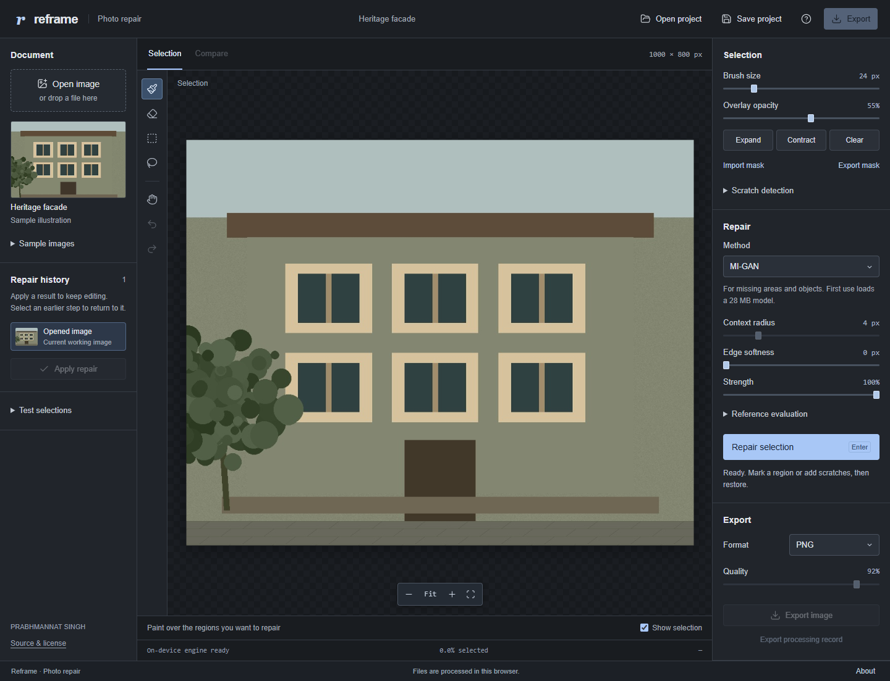

# Reframe

**Photo repair and image inpainting, by PRABHMANNAT SINGH.**

Reframe is a browser-based editor for repairing scratches, removing small unwanted objects, and filling damaged regions of an image. Select an area, run a repair, compare the result, and apply it before continuing. Images stay in the browser; the application does not upload them to a server.



## Features

- **Selection tools:** brush, eraser, rectangle and freehand lasso; Shift-click for straight brush strokes; adjustable overlay opacity; expand, contract, clear, import and export a selection.
- **Three repair methods:** pretrained MI-GAN, fast context fill and an experimental edge-guided GAN. The methods run in a dedicated worker to keep the editor responsive.
- **Repair history:** apply a candidate as the next working image, make another selection, and return to an earlier applied step. Up to eight working-image steps are kept in memory. Selection undo/redo is separate and stores 25 actions.
- **Saved projects:** export a `.reframe` file containing the working image, selection, settings, candidate and repair history. Open it later to continue. Project files are stored wherever you download them, not in an application account.
- **Comparison and navigation:** drag directly across the comparison image or use the slider; zoom, pan and fit the image to the canvas.
- **Cancelable processing:** cancel a long repair or scratch-detection operation without changing the current image or selection. The next operation starts a fresh worker.
- **Export:** PNG, JPEG or WebP, with adjustable quality for JPEG/WebP; a separate JSON processing record includes method, model provenance, settings, input hashes and reference scores when applicable.

## Quick start

Install **Node.js 22.12 or newer**. Node.js 24 is also supported.

```bash
git clone https://github.com/PRABHMANNAT/GAN-BASED-IMAGE-INPAINTING.git
cd GAN-BASED-IMAGE-INPAINTING
npm ci
npm run dev
```

Open the URL printed in the terminal, normally `http://127.0.0.1:5173`. On Windows, `start_windows.bat` installs dependencies when needed and starts the editor. `start_studio_windows.bat` remains available as a compatible launcher. Internet access is needed to install packages; the app and its models are served locally after setup.

To run a production build locally:

```bash
npm run build
npm run preview
```

The generated website is in `web/dist`.

## Using the editor

1. **Open image:** choose a JPEG, PNG or WebP, or drop it onto the document panel. Files may be up to 20 MB. The editor makes an opaque, EXIF-oriented working copy with its aspect ratio preserved and a maximum dimension of 1,200 pixels. Very narrow images whose working copy would be smaller than 32 pixels on either side are rejected.
2. **Select damage:** use brush, rectangle or lasso. Use the eraser to subtract from the selection. Expand/Contract changes the selection boundary by two pixels. White means repair in an imported/exported binary mask; the mask must match the working dimensions.
3. **Repair selection:** choose a method and adjust softness/strength. Context radius is enabled only for context fill. Select less than 60% of the image so enough surrounding information remains.
4. **Compare:** inspect the before/after result. The candidate is not committed until you choose **Apply repair**. Applying a result creates a history step and clears the selection for another pass.
5. **Save or export:** Save project keeps editable work in a `.reframe` file. Export writes the candidate image, or the current applied repair when there is no candidate, in the selected output format. Export the processing record separately if you need provenance.

Clicking an earlier history step changes the working image and clears the current selection/candidate. Applying a new repair from that step creates a new branch and removes the later steps. Oldest steps are removed after the eight-step limit. Saving a project does not alter this in-memory history, but may omit older inactive steps to keep the project below the 40 MB file limit. The current working image and candidate are retained.

Scratch detection is available in the Selection panel. It uses morphological top-hat/black-hat operators to suggest narrow high-contrast marks; it can also select real edges, lettering or hair. Inspect and correct the suggestion before repairing.

### Keyboard shortcuts

| Key | Action |
| --- | --- |
| B / E / R / L / H | Brush / Eraser / Rectangle / Lasso / Pan |
| [ / ] | Decrease / increase brush size |
| Shift + brush click | Draw from the previous brush endpoint |
| Ctrl/Cmd + Z | Undo selection change |
| Ctrl/Cmd + Shift + Z | Redo selection change |
| Space + drag | Pan |
| Mouse wheel | Zoom |
| Enter | Repair selection |
| Escape | Cancel processing |

Shortcuts do not override text fields or open dialogs.

## Deploy to Vercel

Import this GitHub repository into Vercel and keep **Root Directory** set to **`./`**. The committed configuration sets:

| Setting | Value |
| --- | --- |
| Framework | Vite |
| Install command | `npm ci` |
| Build command | `npm run build` |
| Output directory | `web/dist` |
| Node.js | 22.12+ or 24 |
| Environment variables | None |

Vercel only serves static files. There is no Python function, cloud inference service, database or secret to configure. Models and matching WebAssembly runtime files are included in the build. See [DEPLOY_TO_VERCEL.md](DEPLOY_TO_VERCEL.md) for additional hosting notes. Deployment is performed by the repository owner.

## Repair methods

| Method | Implementation | Limitations |
| --- | --- | --- |
| MI-GAN | Author-released MI-GAN-512-Places2 ONNX pipeline v2; CPU/WebAssembly | Generates plausible content rather than recovering historical ground truth; can change object structure or lettering |
| Context fill | Original distance-ordered weighted propagation from surrounding pixels | Fast for narrow scratches and smooth backgrounds; does not synthesize complex objects or textures |
| Edge-guided GAN | A five-channel U-Net conditioned on masked RGB, binary mask and visible Canny edges; trained adversarially | Small teaching checkpoint trained for 300 steps on procedural facade illustrations, not a dependable photo-restoration model |

The first neural repair loads its model and ONNX runtime from the same website. MI-GAN is approximately 28 MB. Loaded sessions are reused until the page or worker is reset. Browser CPU speed and available memory affect processing time; use smaller selections or context fill on less powerful devices. WebGPU is not required.

This software is an independent implementation inspired by the project report's preparation, generation, compositing and review workflow. Neither included neural model is the report's trained EdgeAwareGAN, and the application does not claim the report's accuracy or reproduce its experiment.

### Pixel preservation and evaluation

The in-memory composite copies visible pixels exactly and changes only the binary selection. Softness blends inward. MI-GAN uses a five-pixel internal inference margin to keep its own boundary feathering outside the actual selection; final composition still uses the user's mask. Hidden target pixels are removed before neural conditioning.

**PNG preserves the composite pixels. JPEG and WebP exports use lossy compression**, so decoded output can differ outside the repaired area. Processing-record preservation checks and PSNR scores describe the in-memory composite before export encoding.

Reference evaluation is optional. Enable it only when the working image is an undamaged reference and the selection simulates missing pixels. Uploaded images default to no reference; applying a repair or returning to a history step also disables reference evaluation. Scores against an already damaged image are not measures of restoration accuracy. Infinite PSNR is represented as `null` in JSON. SSIM is not implemented.

## Privacy and project files

- Image processing is performed locally in a Web Worker. No image-upload, analytics or remote-inference endpoint is used.
- Models, icons and runtime assets are served from the same origin. The browser may cache these ordinary static assets.
- No photos or projects are automatically saved in browser storage. Save project downloads a self-contained file; keep it if you want to resume later.
- A project contains the working-size images, selection and metadata, not the full-resolution original scan or its EXIF metadata. Keep original photographs separately.
- Project imports validate the format/version, dimensions, setting ranges and history. Embedded image data must be PNG; external image URLs are rejected. Invalid files leave the open document in place.

## Development and verification

```bash
npm test
npm run test:browser
npm run build
```

`npm test` runs numerical, selection and project-format tests. Browser tests build and serve the production application, run all three repair methods, verify hidden-target invariance, exercise project save/open and history, check cancellation/recovery, inspect actual exported PNG/JPEG/WebP signatures, and check responsive layout and absent external network calls.

Browser tests use a local Chrome installation on Windows when available. Otherwise install Chromium with:

```bash
cd web
npx playwright install chromium
cd ..
npm run test:browser
```

You may instead set `PLAYWRIGHT_CHROMIUM_EXECUTABLE` to a supported Chromium executable.

### Source layout

```text
web/index.html                 Editor structure and controls
web/src/main.js                Workspace, selection tools, project I/O and exports
web/src/project.js             Project schema validation and selection morphology
web/src/style.css              Responsive editor styling
web/public/processor.js        Repair and analysis worker
web/public/repair-core.js      Context fill, masks, compositing and PSNR
web/public/models/             ONNX models, licenses and provenance
web/scripts/prepare-runtime.mjs  Matching runtime assets and license notices
web/tests/                     Unit and browser tests
vercel.json                    Static deployment configuration
LICENSE                        MIT license for original application code
```

The original Flask/PyTorch demonstration and training source are retained for study. They are separate from the current browser editor and are not needed for Vercel. Its Windows launcher is `start_python_demo_windows.bat`. See [Python demo instructions](docs/PYTHON_DEMO.md). `export_web_model.py` exports the teaching model and verifies numerical parity with PyTorch.

## Author and license

**PRABHMANNAT SINGH**

Copyright © 2026 PRABHMANNAT SINGH. Original application code is released under the [MIT License](LICENSE).

Included third-party models and libraries retain their own copyright notices and licenses; the root license does not replace them. See [third-party notices](web/THIRD_PARTY_NOTICES.md) and the bundled model/runtime license files.

MI-GAN is by Andranik Sargsyan, Shant Navasardyan, Xingqian Xu and Humphrey Shi, *MI-GAN: A Simple Baseline for Image Inpainting on Mobile Devices*, ICCV 2023. The [official repository](https://github.com/Picsart-AI-Research/MI-GAN) links the redistributed pipeline and its weights license. The separate teaching model and sample illustrations are part of this project. The user's report PDF is not redistributed.
